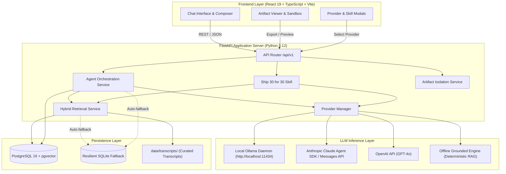
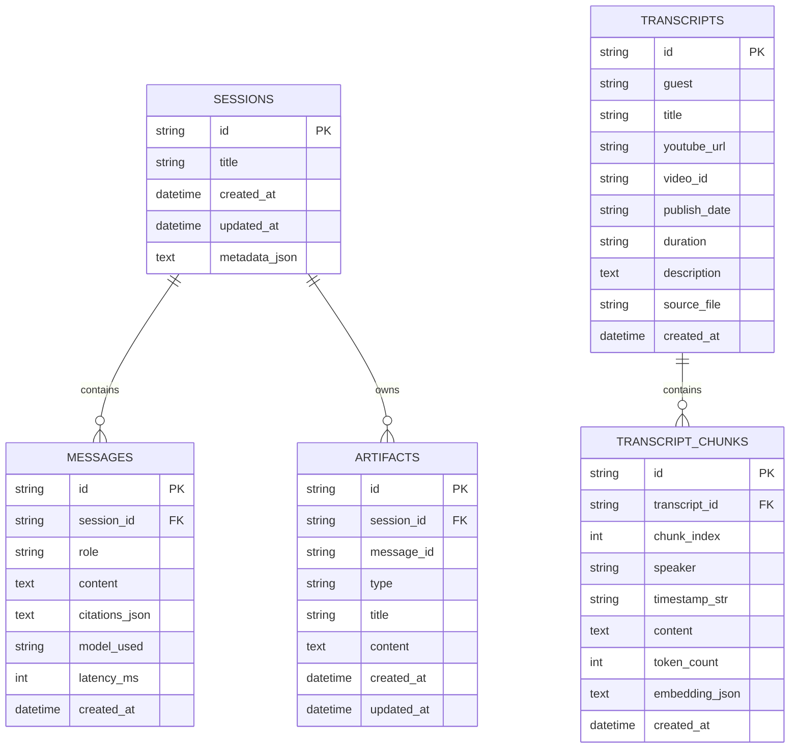

# System Architecture & Technical Specifications
## The Lenny Growth Assistant
**Author:** Forward Deployed Engineering Team  
**Date:** October 12, 2026

---

## 1. System Architecture Overview



---

## 2. Component Boundaries & Responsibilities

1. **`AgentService` (`backend/app/services/agent_service.py`):**
   * Coordinates conversation sessions, user query handling, past context retrieval, RAG retrieval calls, active provider routing, and automatic artifact extraction.
   * Enforces zero-hallucination guardrails and generates contextual follow-up recommendations.
2. **`RetrievalService` (`backend/app/services/retrieval_service.py`):**
   * Loads transcript markdown files from `data/transcripts/`, parses YAML frontmatter, normalizes dialogue, and generates overlapping chunks (approx. 130 words with 25-word overlap).
   * Maintains hybrid TF-IDF vector embeddings and vocabulary indexes.
   * Performs cosine similarity matching with PM concept boosts and strict vocabulary coverage verification (`vocab_coverage >= 55%`, `base_score >= 0.08`).
3. **`Ship30Service` (`backend/app/services/ship30_service.py`):**
   * Encodes the Ship 30 for 30 writing methodology: target 1,250 words, 1-3-1 sentence hook, 5-part narrative arc, descriptive headings, and strict transcript grounding.
   * Persists synthesized essays as Markdown artifacts linked to the session.
4. **`ArtifactService` (`backend/app/services/artifact_service.py`):**
   * Manages artifact creation, listing, retrieval, and file downloads.
   * Enforces HTML sanitization: strips `<script>`, `<iframe>`, `<object>`, `<embed>`, `<form>`, inline event handlers, and `javascript:` URIs.
   * Injects strict Content Security Policy meta tags and boilerplate styles into untrusted HTML fragments.
5. **`ProviderManager` (`backend/app/services/llm_provider.py`):**
   * Manages active LLM provider selection and model configuration without restarting the application.
   * Implements fast connection timeouts (1.5s - 2.5s) to avoid unhandled hangs when local daemons are offline.
   * Provides transparent status inspection for evaluators.

---

## 3. Database Schema & Persistence Strategy

### 3.1 Entity Relationship Diagram



### 3.2 Dual-Engine Persistence & Resilient Fallback
* **Primary Target:** PostgreSQL 15+ with pgvector support (e.g. Supabase, Railway, Neon, local Docker).
* **Automatic Fallback:** If `DATABASE_URL` is unreachable or times out during startup, the database engine seamlessly switches to SQLite (`./data/lenny_assistant.db`) without throwing fatal runtime exceptions.
* **Schema Initialization:** DDL script provided at `backend/migrations/init.sql` and auto-executed on startup via SQLAlchemy `create_all()`.

---

## 4. API Endpoints & Request Contracts

| Method | Endpoint | Description | Status Code |
| :--- | :--- | :--- | :--- |
| `GET` | `/health` | Health probe (database status, active provider) | `200 OK` |
| `GET` | `/ready` | Readiness probe (episodes & chunks count) | `200 OK` |
| `GET` | `/api/v1/sessions` | List all conversation sessions | `200 OK` |
| `POST` | `/api/v1/sessions` | Create a new conversation session | `201 Created` |
| `GET` | `/api/v1/sessions/{id}` | Get session details | `200 OK` |
| `PATCH`| `/api/v1/sessions/{id}` | Rename session title | `200 OK` |
| `DELETE`| `/api/v1/sessions/{id}`| Delete session and cascade messages | `204 No Content` |
| `GET` | `/api/v1/sessions/{id}/messages` | Get messages in chronological order | `200 OK` |
| `POST` | `/api/v1/chat` | Send prompt, perform RAG, return grounded answer | `200 OK` |
| `GET` | `/api/v1/providers` | Inspect all LLM providers and connectivity | `200 OK` |
| `POST` | `/api/v1/providers/select` | Switch active provider and target model | `200 OK` |
| `GET` | `/api/v1/transcripts` | List all ingested Lenny's Podcast episodes | `200 OK` |
| `GET` | `/api/v1/transcripts/search`| Raw hybrid vector search test endpoint | `200 OK` |
| `POST` | `/api/v1/ingest` | Re-index transcripts from local archive | `200 OK` |
| `GET` | `/api/v1/ingest/status` | Ingestion statistics breakdown | `200 OK` |
| `POST` | `/api/v1/ship30/generate` | Generate ~1,250-word Ship 30 essay & artifact | `200 OK` |
| `GET` | `/api/v1/artifacts` | List artifacts, optionally filtered by session | `200 OK` |
| `POST` | `/api/v1/artifacts` | Create and sanitize an artifact | `201 Created` |
| `GET` | `/api/v1/artifacts/{id}`| Retrieve single artifact by ID | `200 OK` |
| `GET` | `/api/v1/artifacts/{id}/export` | Download artifact as `.html` or `.md` file | `200 OK` |

---

## 5. Artifact Security & Isolation Strategy

Rendering AI-generated HTML presents severe Cross-Site Scripting (XSS) and DOM hijacking risks. The Lenny Growth Assistant implements defense-in-depth security:

```
[Untrusted AI / User Content]
             │
             ▼
[Server-side Sanitization: Regex & AST Filter]
   - Strips <script>, <iframe>, <object>, <embed>, <form>
   - Strips inline on* event handlers (onclick, onload, onerror)
   - Strips javascript: URI references
             │
             ▼
[Security Policy Injection]
   - Injects: <meta http-equiv="Content-Security-Policy" content="default-src 'none'; style-src 'unsafe-inline'; font-src data:; img-src data: https:;">
             │
             ▼
[Database Persistence (artifacts table)]
             │
             ▼
[Frontend Sandboxed Iframe (ArtifactViewer.tsx)]
   - <iframe sandbox="allow-popups" srcdoc={content} />
   - Script execution is strictly blocked
   - Same-origin DOM access is prohibited
   - Network fetches & form submissions are blocked
```

---

## 6. Deployment & Docker Topology

* **Multi-container Architecture:**
  * `postgres`: `pgvector/pgvector:pg16` with persistent volume `postgres_data`.
  * `backend`: Python 3.12-slim FastAPI app with curl healthchecks on `/health`.
  * `frontend`: Multi-stage build with Nginx on alpine serving static client bundle.
* **Host Ollama Connectivity:**
  * In Docker Compose, the backend connects to host-installed Ollama via `host.docker.internal:11434`.
  * Evaluators can also run both services bare-metal:
    * Backend: `uvicorn backend.app.main:app --port 8000 --reload`
    * Frontend: `npm run dev`
